<div align="center">

# ✨ Analytics Studio

### AI report builder on top of a governed semantic layer
**Describe a report in plain language → get live KPIs, charts and tables in seconds, with numbers you can trust.**


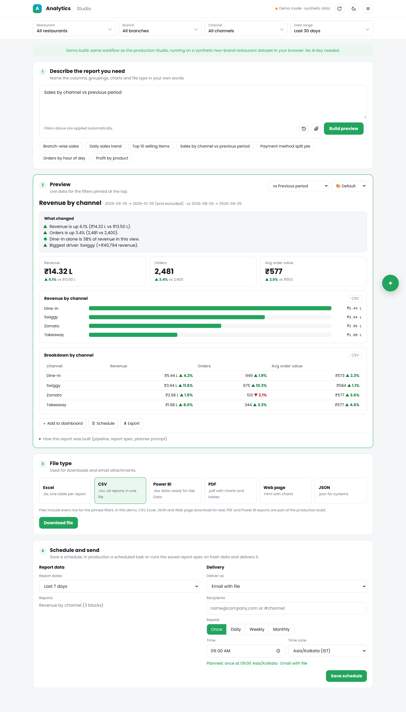

</div>

> **About this repo.** Analytics Studio is an AI product I designed and built at work (Aug 2025 – Oct 2026) for restaurant clients. This repository is a **clean-room reference implementation**, written from scratch to show the architecture and engineering decisions. It contains **no company code, brand, client names, credentials or data**. Everything runs on a synthetic dataset (two fictional restaurant brands, five branches). **Download [`analytics-studio-demo.html`](analytics-studio-demo.html) and open it: one file, no setup, no API key.** The demo uses the same layout and workflow as the production Studio.

---

## 📌 Contents

1. [The problem](#-the-problem)
2. [What Analytics Studio does](#-what-analytics-studio-does)
3. [What I built (key points)](#-what-i-built-key-points)
4. [Architecture](#%EF%B8%8F-architecture)
5. [How it works, step by step](#-how-it-works-step-by-step)
6. [Deep dive into each component](#-deep-dive-into-each-component)
7. [The infrastructure work: preparing the semantic layer for AI](#%EF%B8%8F-the-infrastructure-work-preparing-the-semantic-layer-for-ai)
8. [Real-life use cases](#-real-life-use-cases)
9. [Screenshots](#%EF%B8%8F-screenshots)
10. [Run the demo / connect real data](#%EF%B8%8F-run-the-demo)
11. [Repository structure](#%EF%B8%8F-repository-structure)
12. [Design decisions & lessons](#-design-decisions--lessons)
13. [Author](#-author)

---

## 🎯 The problem

Before Analytics Studio, every custom report followed the same slow loop:

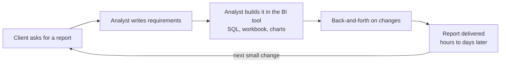

- ⏳ **Hours per report**, and every small change ("add AOV", "only Swiggy", "compare with last month") restarted the loop
- 👩‍💻 **The data team became a report factory** instead of improving the data platform
- 🔁 **The same KPI got re-implemented** in many reports, so numbers drifted
- 🙋 **Clients couldn't self-serve.** BI tools were too complex for restaurant owners

## 💡 What Analytics Studio does

> **One prompt replaces hours of report building.**

A client types *“Revenue by channel for the last 30 days vs previous period”*, uploads a requirement file or pastes a screenshot of a report they like. Seconds later they get:

- 📊 **Live KPIs, charts and tables** from their own data, respecting their access rights
- ↔️ **Comparisons**: previous period, last week, same period last year
- 🔎 **Click-to-drill-down** on any bar or slice
- 💡 **“What changed” insights**: biggest movers, concentration, best day
- 🧮 **Cross-source analysis** such as revenue + recipe cost = **profit and margin**, with verified joins
- 📤 **Exports** (Excel, CSV, PDF, Power BI, HTML) and **scheduled delivery** (email, Slack, Google Sheets)
- 🤖 **An assistant** that sets filters, builds, saves and shares reports from short prompts

**The impact on the team:** reports became self-serve, so the data team's job shifted from building one-off reports to **infrastructure and data modeling** (models, metrics views, data quality). That's where the leverage is.

---

## 🧑‍💻 What I built (key points)

| Area | What I did |
|---|---|
| 🧠 **AI product design** | Defined the product from scratch: problem, users, UX, the AI/data boundary and the roadmap. Shipped versions 1.0 → 1.7 |
| 📝 **Report spec** | Designed a JSON “report spec” as the contract between the LLM and the app. **The AI never writes SQL and never sees raw data** |
| 🔌 **MCP integration** | Connected the app to the semantic layer through **MCP tools** (`list/get/query_metrics_view`), using each user's own login so **row-level security** holds |
| ✅ **Validation layer** | Every AI plan is checked field by field against the live catalog; invalid parts are repaired or dropped and reported, never silently guessed |
| 🔗 **Deep-dive agent** | Multi-view analysis: verifies join keys on real data before merging, computes calculated fields null-safely (missing ≠ 0) |
| 📈 **Analysis features** | Period comparisons, drill-down, insights, targets, forecasts, KPI alerts |
| 📤 **Delivery** | Exports in 5 formats; scheduled reports to email, Slack and Google Sheets; dashboards and team sharing with roles |
| 💸 **Token optimization** | Local edits without the LLM, plan caching, compact catalog prompts, so most follow-ups cost **zero AI tokens** |
| 📦 **Distribution** | Packaged as a versioned **npm** module behind a tiny loader, so every client gets new features instantly with no redeploys |
| 🏗️ **Infrastructure** | Prepared the semantic layer for AI: naming, descriptions, grains, RLS attributes, performance and data-quality checks |

---

## 🏗️ Architecture

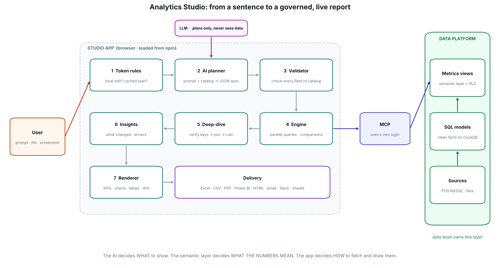

**Three responsibilities, cleanly separated:**

| Layer | Decides | Owned by |
|---|---|---|
| 🤖 **LLM (planner)** | **WHAT** to show: which measures, dimensions, chart types, dates | prompt + catalog |
| 📐 **Semantic layer** | **WHAT THE NUMBERS MEAN**: one definition of revenue, orders, AOV… plus who can see what | data team |
| 🖥️ **Studio app** | **HOW** to fetch, combine, check and draw | application code |

This split is the most important design decision. Because the LLM only *plans*, it can't invent a revenue formula, leak another client's data or run an expensive query. The worst it can do is propose a field that doesn't exist, and the validator catches that.

---

## 🔄 How it works, step by step

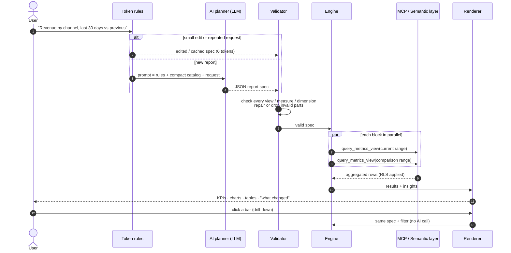

| # | Step | What happens | AI used? |
|---|---|---|---|
| 1 | **Token rules** | Is this a small edit (“make it a pie”, “top 5”, “only Zomato”, “last month”) or a request we've already planned? Apply it locally. | ❌ |
| 2 | **Planner** | Build a prompt with the rules, a compact catalog (names + descriptions, never data) and the request. The LLM returns a JSON report spec. | ✅ once |
| 3 | **Validator** | Check each block against the live catalog. Unknown measure → dropped with a warning. Pie chart for a trend → switched to line. No valid blocks → clear error. | ❌ |
| 4 | **Engine** | Resolve dates (half-open ranges), build one query per block, plus comparison queries, and run them in parallel through MCP. Results are cached per session. | ❌ |
| 5 | **Deep-dive** | For join blocks: query both views at the shared grain, measure key overlap, merge only if keys really match, compute calculated fields. | ❌ |
| 6 | **Insights** | From the fetched results: KPI movement, biggest driver, concentration, best day, join health. | ❌ |
| 7 | **Render & deliver** | KPI tiles, SVG charts, sortable tables. Drill-down re-runs the same spec with a filter. Export or schedule. | ❌ |

> 💸 **Only step 2 costs tokens**, and it is skipped for edits, drill-downs, re-runs and repeated requests.

---

## 🔬 Deep dive into each component

<details open>
<summary><b>1. The report spec: the contract between AI and app</b> · <a href="src/spec.js"><code>src/spec.js</code></a></summary>

The LLM's only output is a small JSON document. Example for *“Profit by product”*:

```json
{
  "title": "Profit by product",
  "date_range": { "preset": "last_30_days" },
  "compare": null,
  "filters": [],
  "blocks": [
    {
      "type": "join",
      "left":  { "view": "item_sales",   "measures": ["item_revenue"] },
      "right": { "view": "recipe_costs", "measures": ["food_cost"] },
      "on": ["product"],
      "calc": [
        { "name": "profit", "label": "Profit",   "expr": "item_revenue - food_cost", "format": "currency" },
        { "name": "margin", "label": "Margin %", "expr": "(item_revenue - food_cost) / item_revenue", "format": "percent" }
      ],
      "sort": { "by": "profit", "desc": true },
      "limit": 15
    }
  ]
}
```

| Block | Purpose | Key fields |
|---|---|---|
| `kpi` | headline numbers with comparison | `view`, `measures[]` |
| `chart` | `line` (trend over `__time`), `bar` (compare categories), `pie` (share) | `measure`, `dimension`, `grain`, `limit` |
| `table` | breakdowns, drill-down detail | `dimensions[]`, `measures[]`, `sort`, `limit` |
| `join` | measures from two views on shared keys + calculated fields | `left`, `right`, `on[]`, `calc[]` |

**Why a spec and not SQL?** A spec can be validated, diffed, cached, edited locally, saved as a dashboard and re-run on a schedule. SQL from an LLM can do none of that safely. Full schema: [`docs/report-spec.md`](docs/report-spec.md).
</details>

<details>
<summary><b>2. The AI planner and prompt design</b> · <a href="src/planner.js"><code>src/planner.js</code></a></summary>

The prompt has three parts:

1. **Rules**: return JSON only, never SQL, never invent fields, prefer few meaningful blocks, chart-type guidance, when to use a join.
2. **Compact catalog**: one line per metrics view with measure names + one-line descriptions and dimension names. **No data, no row samples.** This keeps prompts small and private.
3. **The request**, plus the current spec when the user is editing an existing report, so the model edits instead of starting over.

```text
VIEW orders: Bill-level sales. One row = one bill. Use for revenue, orders, AOV …
  measures: revenue (Net sales of completed bills); orders (Number of completed bills); aov (Revenue / Orders) …
  dimensions: restaurant, branch, city, channel, payment_method, hour, weekday, status
```

The demo includes an **offline planner** (keyword rules) with the same output format, so the whole pipeline runs without an API key. Plug in any LLM with `AS.planner.setLLM(async prompt => text)`.
</details>

<details>
<summary><b>3. Validation: never trust, always verify</b> · <a href="src/spec.js"><code>src/spec.js</code></a></summary>

LLMs are good at intent but occasionally wrong on details. Every plan is checked against the **live catalog** before any query runs:

| Problem in the plan | What the validator does |
|---|---|
| Unknown metrics view | block dropped, error shown |
| Unknown measure in a KPI block | that measure dropped, warning shown |
| Unknown dimension in a chart | block dropped, error shown |
| Pie chart for a time trend | switched to line, warning shown |
| Join with no shared key | block dropped, error shown |
| Unsafe calc expression | removed (only arithmetic on field names is allowed) |
| Limits too large | clamped (charts ≤ 25 bars, tables ≤ 500 rows) |

Every repair is **visible to the user**. The app never silently "fixes" a number.
</details>

<details>
<summary><b>4. Data access through MCP</b> · <a href="src/mcp-adapter.js"><code>src/mcp-adapter.js</code></a></summary>

All data goes through one adapter with three operations:

| MCP tool | Used for |
|---|---|
| `list_metrics_views` | discover what data exists |
| `get_metrics_view` | measures, dimensions, descriptions (the catalog) |
| `query_metrics_view` | aggregated results: measures × dimensions × time range × filters |

- Queries run with the **user's own credentials**, so the semantic layer applies **row-level security**. A client can never see another client's restaurants, even if the AI asks.
- Results are **cached per session** (by tool + arguments). Re-renders, theme changes and drill-down "back" never re-query.
- Swapping the demo layer for real MCP is one call: `AS.data.useMcp(callTool)`.
</details>

<details>
<summary><b>5. Execution engine and comparisons</b> · <a href="src/engine.js"><code>src/engine.js</code></a></summary>

- **Dates** resolve to **half-open ranges** `[start, end)`, so the last day is never dropped (the classic `BETWEEN` bug).
- **Comparison windows** have the same length: previous period, previous week (−7 days) or previous year.
- Each block becomes one query (+1 for comparison); all blocks run **in parallel**.
- Table comparisons are matched by dimension key, so each row shows its own Δ%.
</details>

<details>
<summary><b>6. Deep-dive agent: verified joins across sources</b> · <a href="src/engine.js"><code>src/engine.js</code></a> · <a href="docs/deep-dive-joins.md">docs</a></summary>

Business questions often span two metrics views: *revenue* lives in sales, *food cost* in recipes. The deep-dive:

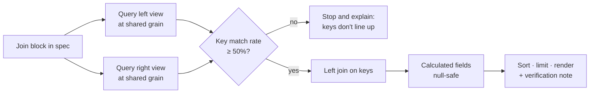

- **Normalised keys** (trimmed, case-insensitive), so "Baner" matches "baner ".
- **Match-rate check before merging.** If keys don't line up (e.g. different naming between systems), it refuses and explains instead of producing wrong numbers.
- **Null-safe calculations**: if cost is missing, profit is blank, **not** revenue − 0 (which would show a fake 100% margin).
- Every joined table shows a note such as *“Verified join on product: 15 of 15 keys matched (100%)”*.
</details>

<details>
<summary><b>7. Insights: “what changed?” for free</b> · <a href="src/insights.js"><code>src/insights.js</code></a></summary>

Computed from results already fetched: no extra queries, no tokens.

- **KPI movement**: “Revenue is up 6.1% (₹14.32 L vs ₹13.50 L)”
- **Biggest driver**: which branch or channel contributed most to the change
- **Concentration**: “Dine-in alone is 38% of revenue”
- **Best period**: best day, week or month in a trend
- **Join health**: match rate of a deep-dive join
</details>

<details>
<summary><b>8. Token optimization</b> · <a href="src/token-rules.js"><code>src/token-rules.js</code></a> · <a href="docs/token-optimization.md">docs</a></summary>

| Technique | Effect |
|---|---|
| **Local edits**: chart type, top N, date preset, compare on/off, single-value filter | 0 tokens |
| **Drill-down & filter chips** re-run the spec | 0 tokens |
| **Plan cache** keyed by normalised request + catalog version | 0 tokens on repeats |
| **Compact catalog**: names + one-line descriptions, no samples | smaller prompts |
| **Edit mode** sends the current spec, so the model returns a small change | fewer output tokens |
| **Session query cache** in the MCP adapter | fewer data calls |

The demo shows a live counter: *planner calls · local edits · cached*.
</details>

<details>
<summary><b>9. Delivery, sharing and distribution</b></summary>

- **Exports**: Excel (one sheet per block), CSV, PDF with charts, Power BI-ready .xlsx, standalone HTML. *(CSV included in this demo.)*
- **Scheduling**: a saved spec + schedule re-runs on time and delivers to email, Slack or Google Sheets. Because the spec is stored, not the data, every delivery is fresh.
- **Dashboards & teams**: specs saved into dashboards, shared with teams (e.g. Analytics, Operations) with roles.
- **Distribution**: the app ships as a versioned **npm package** loaded by a tiny loader page. Publishing a new version updates every client instantly; pinning a major version keeps changes safe.
</details>

---

## 🛠️ The infrastructure work: preparing the semantic layer for AI

An AI report builder is **only as good as the semantic layer under it**. Once reports became self-serve, this became the data team's main job. 📖 Full playbook: [`docs/infra-playbook.md`](docs/infra-playbook.md)

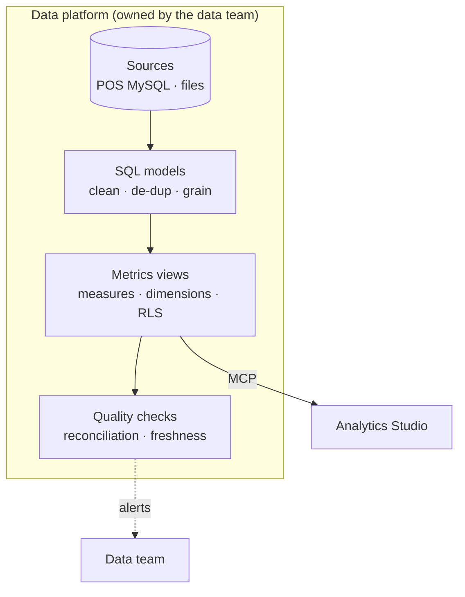

| # | Infra task | Why the AI needs it | Example |
|---|---|---|---|
| 1 | **One fact table per grain** | prevents double counting when the AI combines fields | `orders` (bill) vs `item_sales` (bill line) |
| 2 | **Clear, unique measure names** | the planner picks fields by name | `revenue`, not `sum_amt_2` |
| 3 | **One-line descriptions on every measure** | the LLM reads them to choose correctly | “Net sales of completed bills, after discount, incl. tax” |
| 4 | **Business rules inside measures** | the AI can't forget a filter it never writes | `SUM(CASE WHEN status='completed' …)` |
| 5 | **Shared, consistently named join keys** | deep-dive joins only work if keys match | `branch`, `product` spelled the same in every view |
| 6 | **Row-level security attributes** | AI requests stay inside the user's data | `restaurant_id = {{ .user.restaurant_id }}` |
| 7 | **Time dimension + grains** | trends and comparisons | `order_ts` → day / week / month |
| 8 | **Performance** | prompts → answers in seconds | materialised models on DuckDB, pre-aggregations |
| 9 | **Data-quality checks** | trust: dashboard = POS | duplicate IDs, daily reconciliation, freshness |
| 10 | **Versioning & catalog changes** | renaming a measure must not break saved reports | deprecate, then remove; bump catalog version (invalidates plan cache) |

An **AI-ready metrics view** looks like this ([`examples/metrics_view.yaml`](examples/metrics_view.yaml)):

```yaml
type: metrics_view
display_name: Orders
description: Bill-level sales. One row = one bill. Use for revenue, orders, AOV, channels, branches.
model: orders_enriched
timeseries: order_ts
measures:
  - name: revenue
    display_name: Revenue
    description: Net sales of completed bills (after discount, incl. tax)
    expression: SUM(CASE WHEN status = 'completed' THEN net_amount ELSE 0 END)
security:
  access: true
  row_filter: "restaurant_id = {{ .user.restaurant_id }}"
```

---

## 🌍 Real-life use cases

| User | They type | They get |
|---|---|---|
| 👨‍🍳 Restaurant owner | “How did we do this week vs last week?” | KPIs with Δ%, daily trend vs comparison, biggest driver |
| 🏪 Branch manager | “Swiggy revenue by branch last 7 days” | filtered bar chart + table; click a branch to drill in |
| 📋 Menu team | “Top 10 selling items last month” | qty and item revenue by product, export to Excel |
| 💰 Finance | “Profit by product” | verified join of sales and recipe cost, profit and margin % |
| 🧑‍🍳 Kitchen planning | “Orders by hour of day” | peak-hour bar chart for staffing |
| 📬 Head office | “Send this every Monday to Slack” | scheduled report, always fresh |

---

## 🖼️ Screenshots

All screenshots come from this repository's demo on synthetic data.

| Revenue by channel, vs previous period | Profit by product (verified join) |
|---|---|
|  | 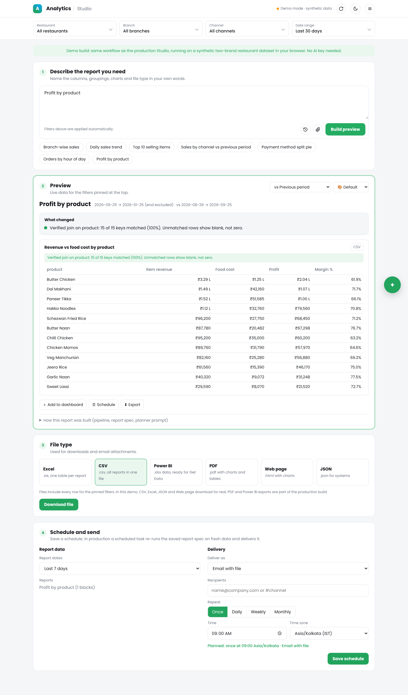 |
| **Top selling items** | **Daily trend this month** |
| 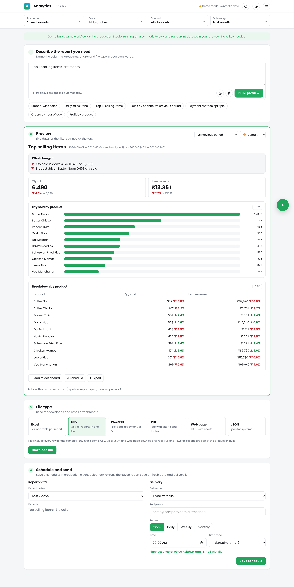 | 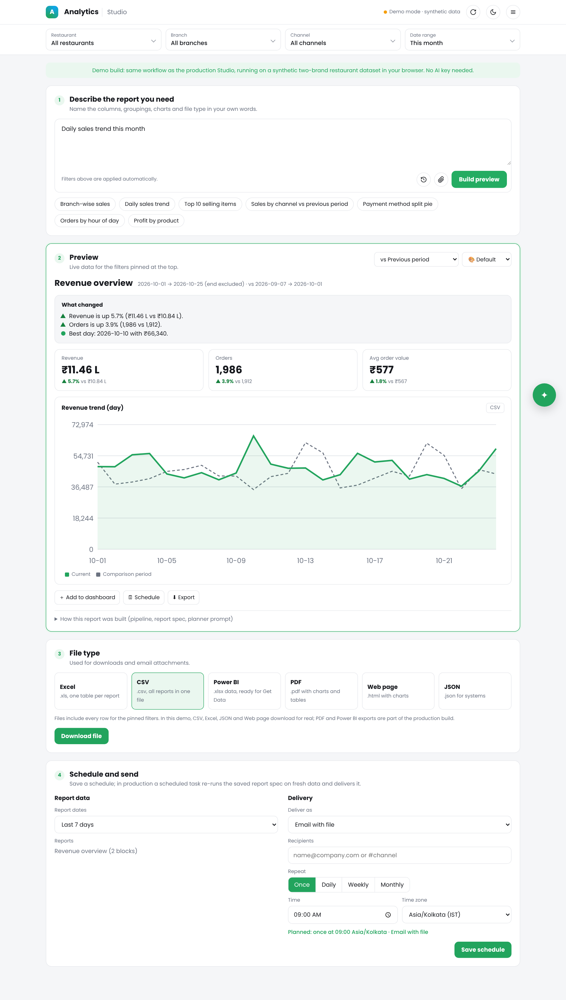 |
| **Branch table with per-row comparison** | **Local edit “make it a pie” (no AI call)** |
| 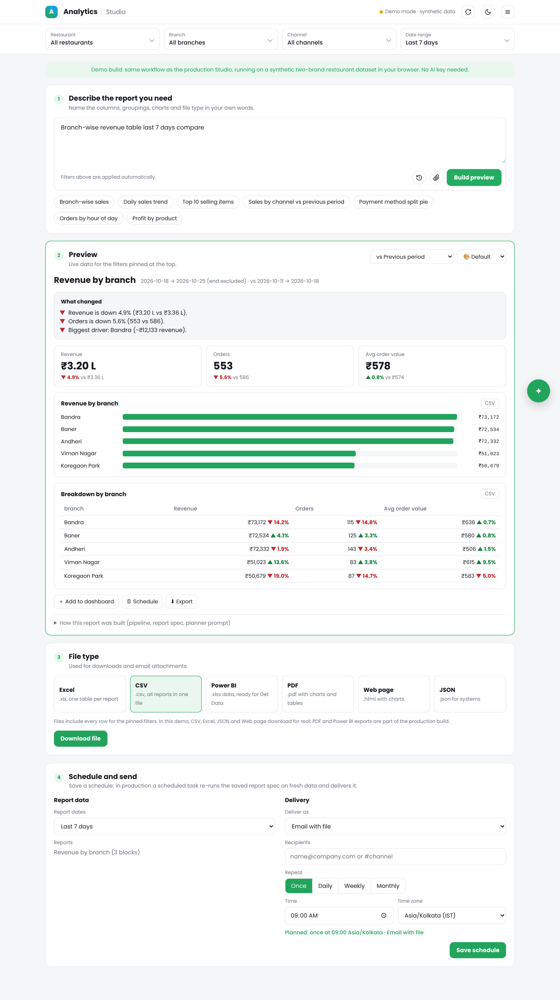 | 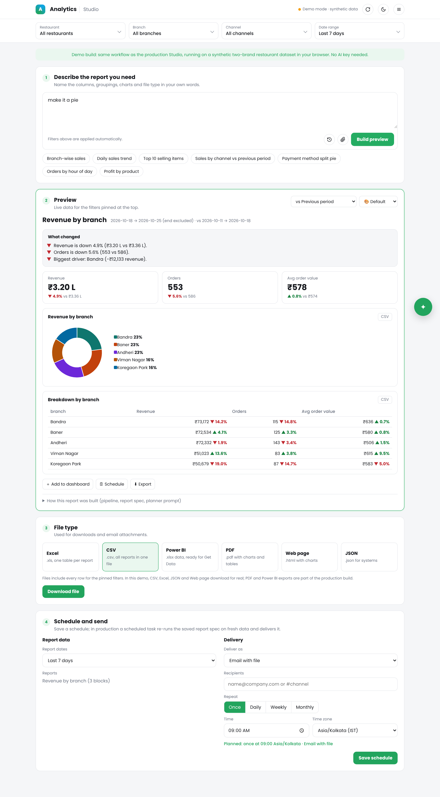 |

---

## ▶️ Run the demo

**Quickest:** download [`analytics-studio-demo.html`](analytics-studio-demo.html) (one self-contained file) and double-click it.

**From source** (no build step, no dependencies):

```bash
git clone https://github.com/suyogpatil395/analytics-studio.git
cd analytics-studio
python3 -m http.server 8000          # then open http://localhost:8000/demo/
python3 build-standalone.py          # regenerates analytics-studio-demo.html after code changes
```

**What to try:**
1. **Pinned filters**: change Restaurant, Branch, Channel or Date range at the top; the preview re-runs (no AI call).
2. **Describe a report**, or click a chip such as *Top 10 selling items* or *Profit by product*.
3. **Ask for changes** in plain words: *make it a pie*, *top 5*, *only Zomato*, *last month*, *compare*. These are handled as local edits with zero AI calls.
4. **Click a bar or pie slice** to drill down.
5. Open **How this report was built** to see the pipeline timings, the JSON report spec and the planner prompt.
6. **Export** (CSV, Excel, JSON, Web page), **Add to dashboard**, **Save a schedule**, or use the **✦ assistant** in the corner.

### Connect a real LLM and real data

```js
// 1. Any LLM that returns text
AS.planner.setLLM(async (prompt) => {
  const res = await fetch("/api/llm", { method: "POST", body: JSON.stringify({ prompt }) });
  return (await res.json()).text;          // the JSON report spec
});

// 2. A semantic layer exposed as MCP tools (list/get/query_metrics_view)
AS.data.useMcp((tool, args) => myMcpClient.callTool(tool, args));
```

Details: [`docs/connect-real-data.md`](docs/connect-real-data.md)

---

## 🗂️ Repository structure

```text
analytics-studio/
├── analytics-studio-demo.html  # ⭐ one-file demo (generated), just open it
├── build-standalone.py       # inlines src/*.js into the one-file demo
├── demo/
│   └── index.html            # the Studio UI: filter bar, requirement box, preview, file type, schedule
├── src/
│   ├── semantic-layer.js     # synthetic metrics views + query engine (stand-in for the real layer)
│   ├── mcp-adapter.js        # single data gateway: demo or real MCP, with session cache
│   ├── spec.js               # report spec, date resolution, validation & repair
│   ├── planner.js            # prompt builder, LLM hook, offline planner
│   ├── token-rules.js        # local edits + plan cache (zero-token paths)
│   ├── engine.js             # parallel execution, comparisons, deep-dive joins
│   ├── insights.js           # "what changed" generation
│   ├── render.js             # KPIs, SVG charts, tables, drill-down, CSV
│   └── app.js                # UI: pinned filters, preview, exports, schedules, dashboards, assistant
├── examples/
│   ├── channel-report.json   # sample specs
│   ├── profit-join.json
│   └── metrics_view.yaml     # an AI-ready metrics view
└── docs/
    ├── report-spec.md
    ├── infra-playbook.md
    ├── deep-dive-joins.md
    ├── token-optimization.md
    ├── connect-real-data.md
    └── images/
```

---

## 🧭 Design decisions & lessons

1. **Let the AI plan, never compute.** Moving all numbers into the semantic layer removed a whole class of “AI made up a number” bugs.
2. **Validate against the live catalog, and show every repair.** Trust comes from transparency.
3. **Missing is not zero.** Null-safe calculations prevented fake 100% margins on unmatched joins.
4. **Most follow-ups don't need a model.** Local edits and caching made the product fast and cheap.
5. **Specs are assets.** Because reports are stored as specs, they can be saved, shared, scheduled and re-run on fresh data.
6. **The semantic layer is the product's foundation.** Investing in names, descriptions, grains and RLS made the AI better than any prompt tweak did.

## 🧰 Tech stack

`LLM planner (Claude)` · `MCP` · `Semantic layer (metrics views on DuckDB)` · `JavaScript (vanilla, no framework)` · `SVG charts` · `npm distribution` · `Email / Slack / Google Sheets delivery`

---

## 👤 Author

<div align="center">

**Suyog Patil**
*Data Engineer · Analytics & AI Product Development*

[](https://www.linkedin.com/in/suyog-patil-0089241b2/)
[](https://github.com/suyogpatil395)

See also: [Rill Client Analytics Platform](https://github.com/suyogpatil395/rill-client-analytics-platform), the semantic layer this kind of product is built on.

⭐ If this helped you think about AI + BI products, consider starring the repo.

</div>
